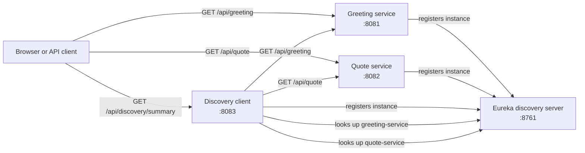

# Architecture

## Overview

This repository is a Maven multi-module Spring Boot example of client-side
service discovery. Eureka stores service instances and their network
locations. The greeting and quote services register themselves as providers;
the discovery client registers as a service and uses Spring Cloud
LoadBalancer to call those providers using their Eureka application names.



The browser/client-to-service arrows show direct HTTP access in the local
example. The consumer-to-provider calls use Eureka-based name resolution and
client-side load balancing.

## Components

| Module | Responsibility | Key implementation |
| --- | --- | --- |
| `discovery-server` | Hosts the Eureka registry and dashboard. It is not itself a Eureka client. | `DiscoveryServerApplication`, `application.yml` |
| `greeting-service` | Registers as `greeting-service`; serves a greeting REST response. | `GreetingServiceApplication`, `GreetingController` |
| `quote-service` | Registers as `quote-service`; serves a quote REST response. | `QuoteServiceApplication`, `QuoteController` |
| `discovery-client` | Registers as `discovery-client`; combines data from both providers. | `DiscoveryClientApplication`, `DiscoveryController` |

Spring Boot and Spring Cloud versions are managed centrally by the root
`pom.xml`. Each application module is independently runnable and has its own
port and `spring.application.name` in `src/main/resources/application.yml`.

## Request and discovery flow

1. Start the Eureka server on port `8761`. It hosts the registry and does not
   register with or fetch from another registry.
2. Start the greeting service, quote service, and discovery client. Each uses
   `http://localhost:8761/eureka/` as its registry URL and registers an
   instance under its configured application name.
3. A client can call either provider directly, or call
   `GET /api/discovery/summary` on port `8083`.
4. The discovery client requests `http://greeting-service/api/greeting` and
   `http://quote-service/api/quote`. The `@LoadBalanced` `RestClient.Builder`
   delegates the service-name lookup and instance selection to Spring Cloud
   LoadBalancer, backed by the Eureka client registry.
5. The discovery client maps the JSON responses to records and returns them
   together as a JSON summary.

The consumer performs both downstream calls in sequence. If a downstream call
fails or the service has no available instance, the HTTP client propagates the
failure; this example intentionally does not provide retries, timeouts,
circuit breakers, or fallback responses.

## HTTP API

| Method | Local URL | Response |
| --- | --- | --- |
| `GET` | `http://localhost:8081/api/greeting` | `{"message":"Hello from a service registered with Netflix Eureka!"}` |
| `GET` | `http://localhost:8082/api/quote` | `{"message":"Great things are done by a series of small things brought together."}` |
| `GET` | `http://localhost:8083/api/discovery/summary` | `{"greeting":{"message":"..."},"quote":{"message":"..."}}` |

Each endpoint is read-only and requires no request body or authentication in
this local demonstration.

## Configuration and extension

Service ports, application names, and Eureka client settings live in each
module's `application.yml`. The registry's `register-with-eureka: false` and
`fetch-registry: false` settings are appropriate for this standalone server;
the provider and consumer modules use the default client behavior and specify
the registry URL.

To add another provider, create a Maven module with the web and Eureka client
dependencies, a unique application name and port, and a REST controller.
Register it as a root Maven module and add its service ID to a consuming
application's load-balanced request URL. Keep consumer calls addressed by
application name rather than by host or port so Eureka instance information
continues to control routing.

## Local run order

Run the following commands from the repository root, each in its own terminal:

```bash
mvn -pl discovery-server spring-boot:run
mvn -pl greeting-service spring-boot:run
mvn -pl quote-service spring-boot:run
mvn -pl discovery-client spring-boot:run
```

Open [http://localhost:8761](http://localhost:8761) to inspect the registry.
Use `GET http://localhost:8083/api/discovery/summary` to exercise the full
consumer-to-provider discovery path.
